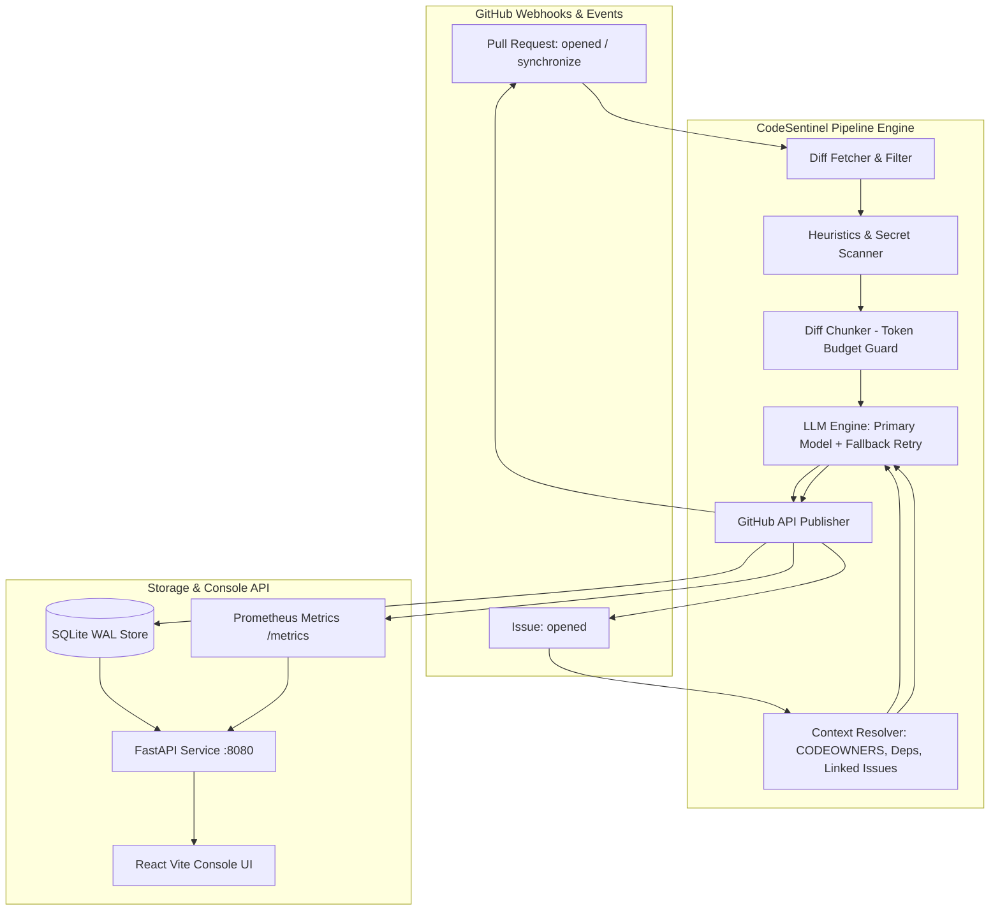

# CodeSentinel AI ???

[](https://github.com/kushmunjal/codesentinel-ai/actions)
[](tests/)
[](pyproject.toml)
[](LICENSE)
[](https://github.com/astral-sh/ruff)
[](action.yml)

**CodeSentinel AI** is an intelligent, high-speed GitHub Action and maintainer console designed for automated pull request reviews and issue triage. Powered by cutting-edge open and commercial LLMs (Groq, OpenAI, Anthropic), CodeSentinel analyzes unified diffs, detects security vulnerabilities, identifies breaking changes, estimates review effort, resolves code ownership, and triages incoming bug reports in seconds.

---

## ??? System Architecture



---

## ? Quickstart

### 1. Add GitHub Workflow

Create `.github/workflows/codesentinel.yml` in your repository:

```yaml
name: CodeSentinel AI Review & Triage

on:
  pull_request:
    types: [opened, synchronize, reopened]
  issues:
    types: [opened]

permissions:
  contents: read
  pull-requests: write
  issues: write

jobs:
  codesentinel:
    runs-on: ubuntu-latest
    steps:
      - name: Checkout Repository
        uses: actions/checkout@v4

      - name: Run CodeSentinel AI
        uses: kushmunjal/codesentinel-ai@v1
        with:
          provider: 'groq'
          model: 'qwen/qwen3.8-27b'
          fallback_model: 'openai/gpt-oss-120b'
          api_key: ${{ secrets.LLM_API_KEY }}
          github_token: ${{ secrets.GITHUB_TOKEN }}
          config_path: '.codesentinel.yml'
```

### 2. Configure Secrets in GitHub
- `LLM_API_KEY`: Your API key for Groq, OpenAI, or custom OpenAI-compatible endpoint.
- `GITHUB_TOKEN`: Standard repository token provided automatically by GitHub Actions (`secrets.GITHUB_TOKEN`).

---

## ?? `.codesentinel.yml` Configuration Reference

Customize CodeSentinel behavior by adding a `.codesentinel.yml` file to the root of your repository:

```yaml
provider: "groq"
model: "qwen/qwen3.8-27b"
fallback_model: "openai/gpt-oss-120b"
base_url: "https://api.groq.com/openai/v1"
severity_threshold: "high"
verbosity: "detailed"

max_files: 50
max_tokens_per_chunk: 2000
token_budget: 100000
cost_budget_usd: 1.00

ignore_paths:
  - "package-lock.json"
  - "yarn.lock"
  - "pnpm-lock.yaml"
  - "Cargo.lock"
  - "poetry.lock"
  - "dist/*"
  - "build/*"
  - "*.min.js"
  - "*.min.css"
  - "*.svg"

enabled_checks:
  secrets: true
  heuristics: true
  bugs: true
  performance: true
  style: true
  tests: true

guidelines:
  - "Ensure public API functions include type annotations"
  - "All database queries must use parameterized statements"
  - "Unit test coverage is mandatory for all new endpoints"
```

### Configuration Matrix

| Parameter | Type | Default | Description |
|---|---|---|---|
| `provider` | `string` | `"groq"` | LLM provider: `groq`, `openai`, `anthropic`, or custom. |
| `model` | `string` | `"qwen/qwen3.8-27b"` | Primary model ID used for review and triage generation. |
| `fallback_model` | `string` | `"openai/gpt-oss-120b"` | Failover model ID used when primary model hits rate limits. |
| `base_url` | `string` | `https://api.groq.com/openai/v1` | OpenAI-compatible API base URL endpoint. |
| `severity_threshold` | `enum` | `"high"` | Minimum finding severity to mark PR as "Needs Attention" (`low`, `medium`, `high`, `critical`). |
| `verbosity` | `enum` | `"detailed"` | Summary output style (`compact` or `detailed`). |
| `max_files` | `integer` | `50` | Maximum changed files before automated review safely bails out. |
| `max_tokens_per_chunk`| `integer` | `2000` | Token limit for individual diff chunk evaluation. |
| `token_budget` | `integer` | `100000` | Upper limit on tokens consumed per PR review run. |
| `cost_budget_usd` | `float` | `1.00` | Dollar safety budget ceiling per review run. |
| `ignore_paths` | `list[str]` | `[lockfiles, dist, build, min.js]` | File glob patterns excluded from diff reviews. |
| `enabled_checks` | `object` | `all true` | Toggle flags for `secrets`, `heuristics`, `bugs`, `performance`, `style`, `tests`. |
| `guidelines` | `list[str]` | `[]` | Custom team rules enforced during PR evaluation. |

---

## ??? Management Console & Screenshots Guide

CodeSentinel includes a real-time web console built with React, Vite, and Tailwind CSS.

### Available Views
- **?? Overview Dashboard (`/`)**: Displays live repository KPIs: Open PRs count, Ready to Merge counter, Issues pending triage, and daily review throughput.
- **?? Pull Requests (`/prs`)**: Interactive table showing PR status, risk level badges (`LOW`, `MEDIUM`, `HIGH`, `CRITICAL`), review effort score (1-5), and author information.
- **??? Issue Triage (`/issues`)**: Real-time triage monitor displaying automated issue type classification, priority ranking, and duplicate detection flags.
- **?? Evaluation Benchmark (`/eval`)**: Machine learning precision, recall, and F1 score benchmark tracking detector accuracy across Python, TypeScript, Go, and Rust.
- **?? Activity Log (`/activity`)**: Audit trail tracking review completions, webhook ingestion events, and feedback signals.
- **?? Settings (`/settings`)**: Live configuration viewer inspecting model targets, token budgets, and active repository rules.

---

## ?? Cost & Token Consumption Estimates

CodeSentinel AI is designed for maximum token efficiency using smart file filtering and AST-aware chunking:

### Cost Estimation Formulas
- **Input Tokens**: `Diff Chunks + Guidelines + Prompt (~1,500 tokens)`
- **Output Tokens**: `Structured Finding JSON (~300 - 600 tokens)`
- **Typical PR (~200 lines modified)**: Consumes ~2,500 total tokens.

### Cost by Model Provider (Per 100 PR Reviews)

| Model Tier | Provider | Cost Per 1K Input | Cost Per 1K Output | Est. Cost / 100 PRs |
|---|---|---|---|---|
| **Qwen 3.8 27B** | Groq | **$0.0002** | **$0.0002** | **~$0.05** |
| **GPT-4o Mini** | OpenAI | **$0.00015** | **$0.00060** | **~$0.07** |
| **Claude 3.5 Haiku** | Anthropic | **$0.00080** | **$0.00400** | **~$0.45** |
| **GPT-4o** | OpenAI | **$0.00250** | **$0.01000** | **~$1.35** |

> [!TIP]
> The default configuration using **Groq Qwen 3.8 27B** allows 1,000+ PR reviews per month for under **$0.50**.

---

## ?? Troubleshooting & FAQ

### 1. `Resource not accessible by integration (403)`
- **Cause**: GitHub Actions lacks permission to write review comments or labels.
- **Fix**: Verify your workflow contains:
  ```yaml
  permissions:
    pull-requests: write
    issues: write
    contents: read
  ```

### 2. `PR exceeds safe limits for automated review`
- **Cause**: PR modified more than 50 files or diff exceeded 50,000 tokens.
- **Fix**: Increase `max_files` or `token_budget` in `.codesentinel.yml`, or split large feature PRs into smaller increments.

### 3. Rate limits from LLM Provider (HTTP 429)
- **Fix**: CodeSentinel automatically retries with exponential backoff. Configure `fallback_model` in your `.codesentinel.yml` to failover to a secondary model.

### 4. Review comments not showing on changed lines
- **Cause**: Comment target line is outside the unified diff patch.
- **Fix**: CodeSentinel automatically maps lines to patch positions using `map_line_to_position`. Lines outside the diff hunk are summarized in the top-level PR comment.
